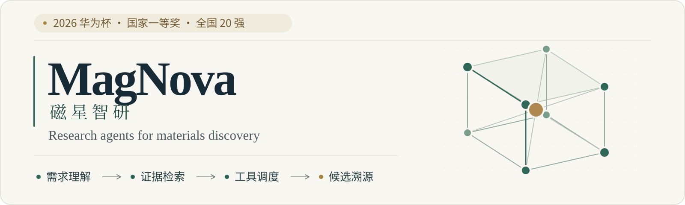
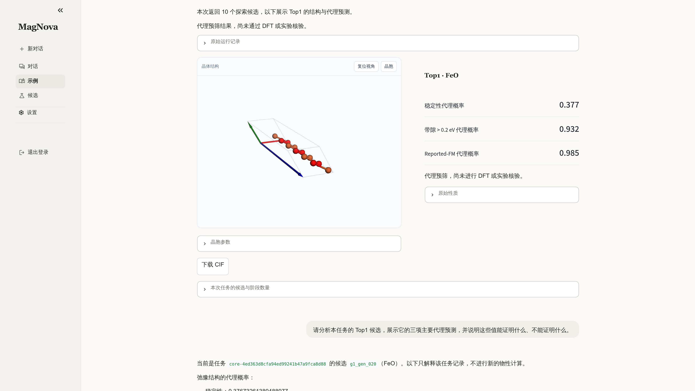
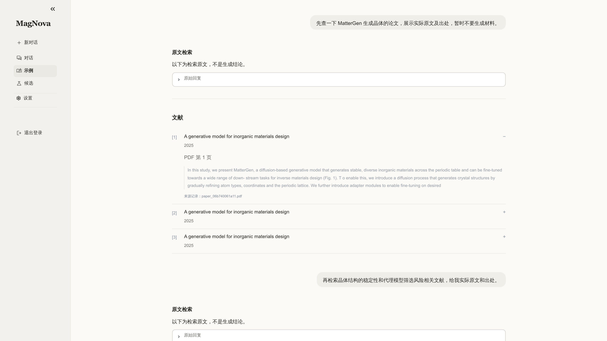
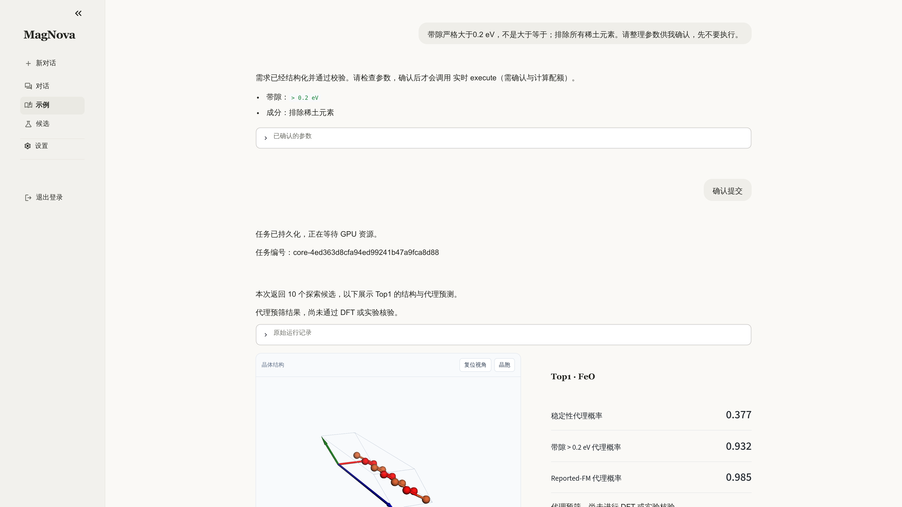
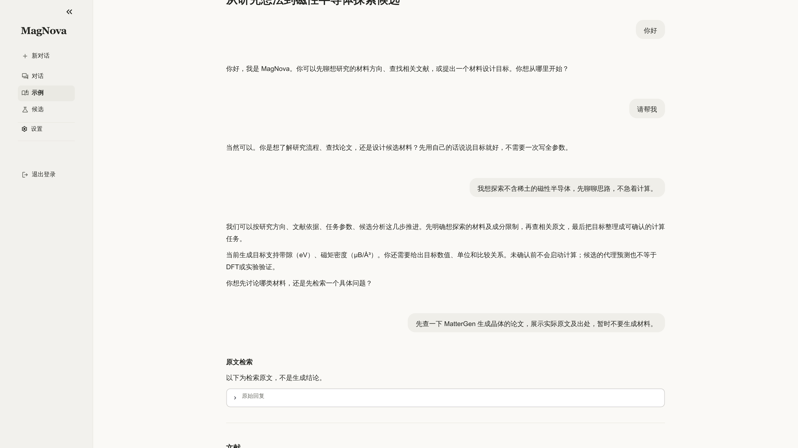
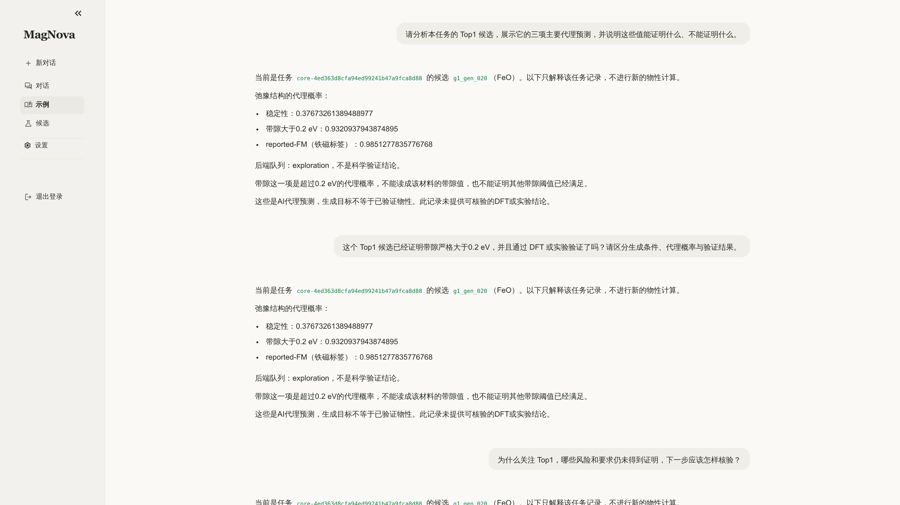
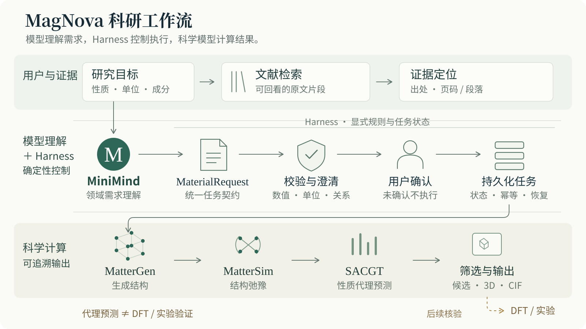

<p align="center">
  
</p>

<p align="center"><strong>From a research question to an evidence-grounded, executable, traceable materials workflow.</strong></p>

<p align="center">
  <a href="README.md">简体中文</a> · <a href="#showcase">Showcase</a> · <a href="docs/showcase-case.md">Recorded case</a> · <a href="#try-the-public-baseline">Get started</a> · <a href="docs/public-release-scope.md">Release scope</a>
</p>

<p align="center">
  <a href="https://github.com/BaikelWang/MagNova/actions/workflows/ci.yml"></a>
  
  
</p>

## MagNova

MagNova is a scientific Agent for exploring magnetic materials. It connects natural-language requirements, literature evidence and materials computation: discuss a research direction, refine constraints, confirm a task, then inspect candidate crystals, property proxies and the next validation steps.

The project received **National First Prize and National Top 20 recognition in the 2026 “Huawei Cup” China Graduate AI Innovation Competition**.

**MiniMind interprets requirements. The Harness governs execution. Scientific tools compute candidates. Original records constrain the explanation.**

> This page showcases the completed competition system. The repository retains a runnable public engineering baseline and selected presentation materials—not the entire final deployment, private scientific implementations or complete datasets. Real historical results and local Mock demonstrations are distinguished throughout. [Release scope →](docs/public-release-scope.md)

## Showcase

### A crystal, its predictions and its provenance—one task



An interactive 3D crystal view is linked to its candidate identifier, original prediction fields and CIF artifact. The candidate shown is exploratory: a proxy probability is not a validated physical property, and Top1 is a ranking position rather than proof that every objective is satisfied.

### Literature that leads back to the original passage



Evidence remains attached to the paper, page and passage it came from. The archived interface provides retrieval and original-text reading; it does not present excerpts as a generated scientific conclusion. [Paper attribution and image notes →](docs/assets/README.md)

### From an open-ended request to explicit execution parameters



Values, units, comparison operators and composition constraints become a typed `MaterialRequest`. Missing fields trigger clarification; conflicting constraints trigger a check. **Strict `>` remains distinct from `>=`, and scientific computation requires explicit confirmation.**

<details>
<summary><strong>Explore the recorded workflow: discussion and result analysis</strong></summary>





The showcase follows discussion → literature → clarification → confirmation → structure → analysis. It is selected from one real scientific task and includes records recovered after an interface repair—not an unedited, uninterrupted autonomous conversation. [Case notes →](docs/showcase-case.md)

</details>

## How the system works



- **MiniMind — requirement understanding.** Domain adaptation, structured requirements and clarification support; not crystal generation or physical-property computation.
- **Harness — reliable execution.** Validation, user confirmation, durable task state, account isolation, recovery and provenance. An unknown result leads to a query of the original task, not a blind resubmission.
- **Scientific tools — candidate computation.** MatterGen proposes structures, MatterSim participates in relaxation, and SACGT supplies property proxies and risk signals. Results remain bound to the task and structure they describe.

Literature supports methodological choices; proxy predictions support pre-screening; DFT and experiments provide further scientific validation. [Architecture and public interfaces →](docs/system-architecture.md)

## A real case, with an explicit evidence boundary

For a task exploring rare-earth-free candidates with a target band gap strictly greater than 0.2 eV, the archived task aggregates report **40 generated structures, 35 passing the prefilter, 34 relaxation/prediction results and 10 candidates returned by default**. The candidates remain exploratory; these counts do not establish a newly discovered or experimentally validated high-performance material. [Stage definitions and validation status →](docs/showcase-case.md)

The full deployed system's **22 October 2026** archive records **1,182 engineering regression tests passed, one skipped, and ten conversation-browser checks passed**. Public-entry checks also covered login, retrieval, the historical case, 3D interaction, CIF download and logout. These are historical engineering checks—not model accuracy, scientific success rates or the current public repository's test count. [Validation notes →](docs/validation.md)

## Try the public baseline

The public baseline defaults to rule-based parsing and a Mock backend. No GPU or model weights are required.

```bash
git clone https://github.com/BaikelWang/MagNova.git
cd MagNova
python -m venv .venv
source .venv/bin/activate  # Windows: .venv\Scripts\activate
python -m pip install -e ".[dev,ui]"
pytest
```

Prepare a requirement contract without executing scientific computation:

```python
from magnova_agent import MagNovaAgent

outcome = MagNovaAgent().prepare(
    "请生成带隙严格大于 0.2 eV 且不含稀土元素的材料"
)
print(outcome.model_dump_json(indent=2))
```

```bash
streamlit run scripts/agent/web_app.py
```

Select **规则 Baseline** when model services are not configured. This is the public baseline interface, **not the complete competition deployment shown above**. Real scientific execution requires separately connected backends and legitimately obtained assets. [Installation and configuration →](docs/getting-started.md)

## Read and reproduce

- [`src/magnova_agent/`](src/magnova_agent/): public Agent logic, contracts, orchestration and task management.
- [`training/minimind/`](training/minimind/): domain-training, checking and export utilities; no model weights or complete corpora.
- [`integrations/mattergen/`](integrations/mattergen/): MatterGen/MatterSim integration experiments.
- [`reports/`](reports/): historical aggregate parsing evaluations, separate from application acceptance.
- [`docs/`](docs/): architecture, case notes, validation, publication scope and showcase images.

## Acknowledgments and rights

We acknowledge the authors of [MiniMind](https://github.com/jingyaogong/minimind), [MatterGen](https://github.com/microsoft/mattergen), [MatterSim](https://github.com/microsoft/mattersim), Pydantic and Streamlit. MagNova focuses on domain adaptation, scientific-workflow collaboration, reliable execution and traceable interaction. Credit for upstream models and tools remains with their authors.

This repository does not distribute weights, the private SACGT implementation, the full paper library, user databases or internal evaluation sets. The showcase update does **not introduce an additional open-source license grant**; existing rights and third-party terms remain applicable. [NOTICE](NOTICE.md) · [Image and paper attribution](docs/assets/README.md) · [Security notes](SECURITY.md)
