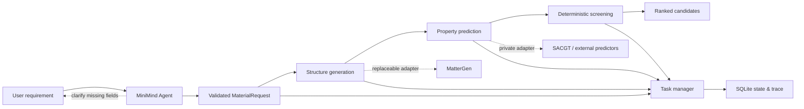

<div align="center">

# 🧲 MagNova

### A MiniMind-powered agent for trustworthy magnetic-material inverse design

**Natural-language requirements → generation → prediction → screening → evidence-ready candidates**

[](https://www.python.org/)
[](https://docs.pydantic.dev/)
[](https://github.com/BaikelWang/MagNova/actions/workflows/ci.yml)
[](#project-status)

[简体中文](README.zh-CN.md) · [Architecture](docs/system-architecture.md) · [Public release scope](docs/public-release-scope.md)

</div>

## Overview

MagNova is an AI-for-Science research platform for magnetic-material inverse design. Its goal is to turn a scientist's natural-language intent into a traceable, machine-verifiable workflow that generates structures, predicts properties, applies deterministic constraints, and returns ranked candidates with provenance.

This repository publishes the **agent and orchestration layer**. MiniMind handles requirement understanding and multi-turn clarification; typed schemas and deterministic programs remain responsible for validation, tool execution, numerical comparison, task state, and failure handling.

> [!IMPORTANT]
> This is a research preview. The built-in backend produces mock candidates for engineering validation only. They are not experimentally or DFT-validated material discoveries.

## System architecture



The LLM is deliberately not the scientific judge. It translates language into a typed request and explains workflow state; scientific models and deterministic code perform generation, prediction, and screening.

## What is included

| Area | Public implementation |
|---|---|
| Requirement understanding | MiniMind/OpenAI-compatible interpreter, rule baseline, JSON extraction, guardrails |
| Contracts | Strict Pydantic schemas for requests, properties, jobs, events, and candidates |
| Conversation | Missing-slot clarification, multi-turn merge, session isolation |
| Orchestration | Submit/poll protocol, retry and backoff policy, timeout and terminal-state handling |
| Persistence | SQLite task store, additive migrations, workflow progress and event trace |
| Pipeline | Replaceable generator/predictor/screener protocols plus an end-to-end mock backend |
| UI | Streamlit research console with live non-blocking task updates |
| Training | MiniMind SFT, tokenizer inspection, embedding inspection, export and dataset-building utilities |
| Generation integration | Reproducible MatterGen → MatterSim screening workflow |
| Quality | Unit tests, smoke tests, golden cases, and a compact evaluation snapshot |

The following are intentionally excluded: model weights, full training/evaluation datasets, SACGT source code and algorithm details, private experimental data, service credentials, internal logs, and large generated structures. See [the release boundary](docs/public-release-scope.md).

## Quick start

The default setup runs completely locally with the rule-based interpreter and mock scientific pipeline.

```bash
git clone git@github.com:BaikelWang/MagNova.git
cd MagNova

python -m venv .venv
source .venv/bin/activate  # Windows: .venv\Scripts\activate
python -m pip install -e ".[dev,ui]"

pytest
magnova-agent "generate a material with band gap > 1.2 eV"
streamlit run scripts/agent/web_app.py
```

Open the Streamlit URL and choose **规则 Baseline** when no MiniMind service is running.

### Connect MiniMind

Start an OpenAI-compatible MiniMind inference service separately, then configure:

```bash
export MINIMIND_API_URL=http://127.0.0.1:8504/v1/chat/completions
streamlit run scripts/agent/web_app.py
```

Weights are deliberately not distributed here. The utilities in [`training/minimind`](training/minimind) document the learning path from base-weight preparation to SFT, evaluation, inspection, and Hugging Face export.

### Connect a real workflow backend

```bash
export MAGNOVA_BASE_URL=http://127.0.0.1:9000
export MAGNOVA_API_KEY=your-token
export MAGNOVA_JOB_TIMEOUT=300
```

The adapter expects an asynchronous contract:

```text
POST /v1/tasks           -> task_id + queued
GET  /v1/tasks/{task_id} -> queued | running | succeeded | failed
```

All responses cross a Pydantic validation boundary before entering the agent state machine.

## Example request

```text
Please generate a rare-earth-free material with magnetic moment density
above 0.2 μB/ų and Curie temperature above 500 K.
```

The agent converts this into a `MaterialRequest`, asks for any missing unit or threshold, submits the job once, persists the task ID, and renders stage-level progress:

```text
queued → generation → prediction → screening → completed
```

## MatterGen screening workflow

[`integrations/mattergen/fm_semiconductor_screening`](integrations/mattergen/fm_semiconductor_screening) contains a reproducible 32-sample generation and MatterSim stability-screening experiment. It exports stable, unique candidates but does **not** establish ferromagnetism or semiconductor behavior; those claims require additional electronic-structure and magnetic-order calculations.

## Evaluation snapshot

The included MiniMind v5.3 hidden-set snapshot contains 300 examples per split. It evaluates **requirement parsing**, not material-property accuracy.

| Split | JSON valid | Schema valid | Property-set exact | Strict contract exact |
|---|---:|---:|---:|---:|
| In-distribution | 100.0% | 100.0% | 96.7% | 13.3% |
| Out-of-distribution | 100.0% | 100.0% | 82.3% | 10.7% |
| Adversarial | 99.7% | 99.7% | 78.3% | 21.3% |

The low strict-contract score is reported rather than hidden: exact matching penalizes any field-level mismatch and shows that robust OOD requirement understanding remains active research. Full aggregate metrics are available in [`reports/v52b_v53_hidden5_summary.json`](reports/v52b_v53_hidden5_summary.json).

## Repository layout

```text
MagNova/
├── src/magnova_agent/          # schemas, agent, conversation, tools, task manager
├── scripts/agent/              # UI, smoke tests, dataset and evaluation utilities
├── training/minimind/          # MiniMind training and inspection utilities
├── integrations/mattergen/     # generation and stability-screening workflow
├── examples/                   # small public golden set
├── reports/                    # aggregate, non-sensitive evaluation snapshot
├── docs/                       # architecture and engineering notes
└── tests/                      # unit and workflow tests
```

## Project status

- [x] Typed natural-language requirement contract
- [x] Multi-turn clarification and safety fallback
- [x] Asynchronous task protocol and persistence
- [x] Replaceable generation/prediction/screening interfaces
- [x] MiniMind SFT and evaluation toolchain
- [x] MatterGen + MatterSim screening experiment
- [ ] Production MagNova service integration
- [ ] Calibrated uncertainty and OOD gating
- [ ] Pareto ranking and diversity-aware selection
- [ ] DFT validation and evidence dossier
- [ ] Human-in-the-loop approval for expensive scientific actions

## Scientific integrity

- Mock output is always labeled as mock output.
- A generated structure is not automatically stable, magnetic, synthesizable, or novel.
- Proxy-model screening is not a substitute for DFT or experiment.
- The agent may explain results, but numerical constraints are enforced by deterministic code.
- Private prediction models must expose provenance, uncertainty, and applicability-domain metadata through the adapter contract.

## Acknowledgements

MagNova builds on the ideas and tooling of [MiniMind](https://github.com/jingyaogong/minimind), [MatterGen](https://github.com/microsoft/mattergen), [MatterSim](https://github.com/microsoft/mattersim), Pydantic, and Streamlit. Their respective licenses apply to upstream software and assets; no upstream model weights are redistributed here.

## License

No open-source license has been granted for the original MagNova code in this repository. The source is published for project review and educational demonstration. Third-party components remain governed by their own licenses.