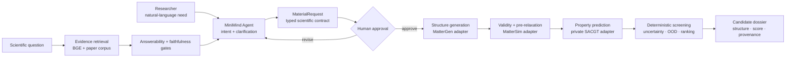

<div align="center">

# 🧲 MagNova

### An evidence-grounded MiniMind agent for magnetic-material inverse design

**Natural-language intent → scientific contract → generation → prediction → screening → traceable candidates**

<p>
  <strong>MagNova Lab · 磁星智研</strong><br/>
  <em>Turn requirements into materials. Make every discovery traceable.</em>
</p>

[](https://www.python.org/)
[](https://github.com/BaikelWang/MagNova/actions/workflows/ci.yml)
[](https://github.com/jingyaogong/minimind)
[](#project-status)
[](#license)

[简体中文](README.zh-CN.md) · [Architecture](docs/system-architecture.md) · [Project status](docs/project-status.md) · [Public boundary](docs/public-release-scope.md) · [Security](SECURITY.md)

</div>

> [!IMPORTANT]
> MagNova is a research prototype. Generated and AI-screened candidates are **not** DFT- or experimentally validated discoveries. Mock results, model predictions, and verified facts are labeled separately throughout the system.

## Why MagNova

Materials design rarely fails because a single model is missing. It fails at the interfaces: a human requirement is underspecified, model inputs drift, an expensive job is submitted twice, a proxy score is mistaken for truth, or a candidate loses its provenance.

MagNova turns that fragmented process into one governed workflow:

- MiniMind understands intent, maintains multi-turn context, and explains results.
- Typed schemas convert language into a machine-verifiable `MaterialRequest`.
- MatterGen-compatible adapters generate crystal candidates.
- MatterSim-compatible stages pre-relax and screen structural plausibility.
- A private SACGT backend predicts magnetic-property proxies and uncertainty metadata.
- Deterministic code enforces constraints, ranking, retries, state transitions, and audit trails.
- Evidence-grounded RAG answers scientific questions with answerability and faithfulness gates.
- Human approval is required before expensive or scientifically consequential tool calls.

The LLM is the interface and coordinator—not the scientific judge.

## End-to-end workflow



## What works today

| Layer | Public implementation | Current state |
|---|---|---|
| Requirement understanding | MiniMind/OpenAI-compatible interpreter, normalization, semantic slot verification, rule fallback | Working |
| Conversation | Multi-turn merge, context isolation, clarification, refusal and approval states | Working |
| Scientific contract | Strict Pydantic models for requests, constraints, jobs, events and candidates | Working |
| Research RAG | Paper ingestion, BGE-compatible retrieval, sentence evidence packing, citations and evidence gates | Research preview |
| Orchestration | LangGraph research flow, async submit/poll, retry/backoff, timeout and terminal-state handling | Working |
| Persistence & telemetry | SQLite task store, additive migrations, redacted interaction records and workflow trace | Working |
| Backend integration | Mock pipeline, asynchronous HTTP backend and CLI bridge to a private scientific backend | Working |
| Web console | Multi-page Streamlit UI, dark/presentation modes, candidate panels, provenance and read-only artifact views | Working |
| Scientific models | MatterGen/MatterSim workflow examples and private SACGT adapter contract | Adapter boundary only |
| Quality | Unit/contract tests, smoke workflows, golden cases and public CI on Python 3.10/3.12 | Active |

## Closed-loop showcase

The following figures come from a completed **32-candidate AI screening run**. They demonstrate the engineering loop and visualization pipeline—not material discovery claims.


In this run, 32 generated structures entered the funnel, 28 passed pre-screening and relaxation, and all 28 entered the exploration queue. The exploitation queue remained empty because the confidence/OOD gate was intentionally conservative.

<table>
<tr>
<td width="50%" align="center"><strong>Generated structure</strong><br/></td>
<td width="50%" align="center"><strong>Pre-relaxed structure</strong><br/></td>
</tr>
</table>

<table>
<tr>
<td width="50%" align="center"><strong>AI ranking</strong><br/></td>
<td width="50%" align="center"><strong>Property proxies</strong><br/></td>
</tr>
</table>

> [!NOTE]
> Scores are frozen AI ranking/proxy outputs. They do not establish stability, ferromagnetic ground state, synthesizability, novelty, or application performance.

## Quick start

The default path is self-contained: it uses the rule interpreter and deterministic mock scientific backend.

```bash
git clone git@github.com:BaikelWang/MagNova.git
cd MagNova

python -m venv .venv
source .venv/bin/activate          # Windows: .venv\Scripts\activate
python -m pip install -e ".[dev,ui]"

pytest
magnova-agent "generate a rare-earth-free material with band gap > 1.5 eV"
streamlit run scripts/agent/web_app.py
```

No model weight or private scientific backend is required for this baseline.

### Evidence-grounded research console

The full console expects separately deployed MiniMind, embedding, and paper-corpus services:

```bash
cp .env.example .env
export MINIMIND_TASK_API_URL=http://127.0.0.1:8506/v1/chat/completions
export BGE_API_URL=http://127.0.0.1:8508/v1/embeddings
export MINIMIND_RESEARCH_API_URL=http://127.0.0.1:8512/v1/chat/completions
export MAGNOVA_RAG_CORPUS=/path/to/audited/paper-corpus

streamlit run scripts/agent/web_app_rag_viz.py
```

The paper corpus and model weights are intentionally not distributed.

## Backend modes

| Mode | Configuration | Purpose | Failure behavior |
|---|---|---|---|
| `mock` | `MAGNOVA_BACKEND_MODE=mock` | UI, contract and orchestration validation | Clearly labeled mock candidates |
| `http` | `MAGNOVA_BACKEND_MODE=http` + `MAGNOVA_BACKEND_URL` | Remote asynchronous scientific service | Explicit failure; never replaced with mock |
| `cli` / `real` | `MAGNOVA_BACKEND_MODE=cli` + CLI environment variables | Local bridge to a private workflow | Explicit failure; never replaced with mock |

The HTTP adapter uses a deliberately small contract:

```text
POST /v1/tasks           -> task_id + queued
GET  /v1/tasks/{task_id} -> queued | running | succeeded | failed
```

Every response crosses a Pydantic validation boundary before it can enter agent state.

## Evaluation and gates

MagNova reports failed gates instead of hiding them.

### Requirement parsing snapshot

The published v5.3 hidden-set snapshot evaluates **language-to-schema parsing**, not scientific property accuracy.

| Split | JSON valid | Schema valid | Property-set exact | Strict contract exact |
|---|---:|---:|---:|---:|
| In-distribution | 100.0% | 100.0% | 96.7% | 13.3% |
| Out-of-distribution | 100.0% | 100.0% | 82.3% | 10.7% |
| Adversarial | 99.7% | 99.7% | 78.3% | 21.3% |

### Evidence verifier research

The latest chunk-level evidence-verifier experiment reached **78.38% question-grouped OOF balanced accuracy**. The internal gate is 80%, so this candidate was **not promoted** and the frozen research-answer baseline was not replaced. See [project status](docs/project-status.md).

### Engineering verification

- Authoritative server workspace: **299 passed, 1 skipped**.
- End-to-end stack smoke: passed for cited scientific Q&A, contextual follow-up, insufficient-evidence refusal, schema generation, approval, and mock handoff.
- Public CI targets Python 3.10 and 3.12.
- Internal data, model files, and sealed evaluations are not part of the public test set.

## Scientific integrity by design

| Risk | Guardrail |
|---|---|
| Hallucinated requirements | Typed schema, normalization warnings and deterministic validation |
| Unsupported scientific answer | Evidence answerability/faithfulness gates and citation checks |
| Accidental expensive execution | Human-in-the-loop approval before tool invocation |
| Duplicate job submission | Persisted task ID and explicit state machine |
| Mock/real result confusion | Mode labels, separate backends and no silent fallback |
| Proxy score treated as truth | Uncertainty/OOD metadata and explicit AI-screening disclaimer |
| Secret or core IP leakage | Environment-only credentials and strict public-release boundary |

## Repository map

```text
MagNova/
├── src/magnova_agent/          # agent, RAG, schemas, orchestration and adapters
├── scripts/agent/              # CLI/UI, smoke, dataset and evaluation utilities
├── training/minimind/          # MiniMind learning, SFT, inspection and export
├── integrations/mattergen/     # reproducible generation/pre-screening example
├── examples/                   # compact public golden cases
├── reports/                    # aggregate, non-sensitive evaluation snapshots
├── docs/                       # architecture, engineering notes and release scope
└── tests/                      # unit, contract and workflow tests
```

## Project status

- [x] Typed natural-language requirement contract
- [x] Multi-turn clarification, refusal, and human approval
- [x] Evidence-grounded scientific RAG workflow
- [x] Async task protocol, persistence, telemetry and failure handling
- [x] Mock, HTTP and private-CLI backend boundaries
- [x] MatterGen → MatterSim → predictor → screening engineering loop
- [x] Industrial Streamlit research console
- [ ] Production HTTP scientific service
- [ ] Calibrated uncertainty and OOD gates
- [ ] Pareto and diversity-aware selection
- [ ] DFT validation and candidate evidence dossier
- [ ] Experimental feedback loop

## Public release boundary

This repository intentionally excludes:

- model weights, checkpoints and vector indexes;
- full training/evaluation datasets and private paper corpora;
- SACGT source code, algorithm details and proprietary predictors;
- private candidate structures, full run artifacts and experimental data;
- secrets, service credentials, internal logs and machine-specific runtime state.

See [Public release scope](docs/public-release-scope.md) for the complete boundary.

## Acknowledgements

MagNova builds on the ideas and tooling of [MiniMind](https://github.com/jingyaogong/minimind), [MatterGen](https://github.com/microsoft/mattergen), [MatterSim](https://github.com/microsoft/mattersim), LangGraph, Pydantic and Streamlit. Upstream projects and assets remain governed by their respective licenses.

## License

No open-source license has been granted for original MagNova code in this repository. The source is published for project review, research communication and educational demonstration. Third-party components remain under their own licenses.

<div align="center">

**MagNova Lab · 磁星智研**

*让需求成为材料，让发现有据可循。*

</div>
