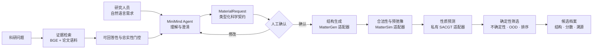
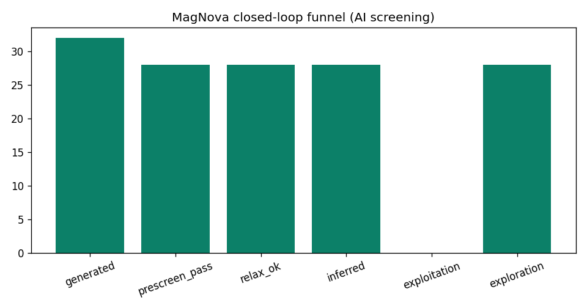
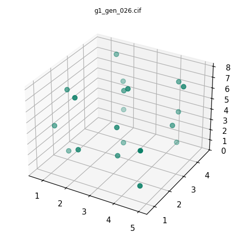
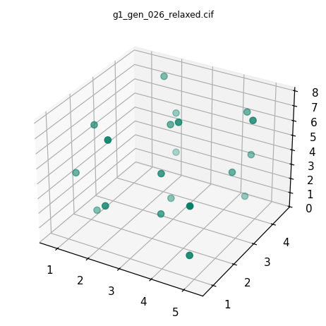
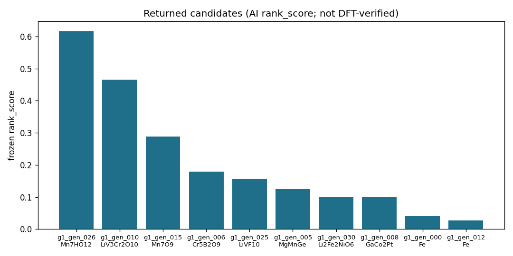
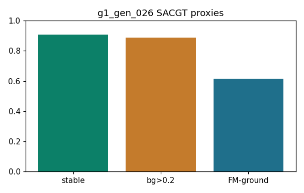

<div align="center">

# 🧲 MagNova

### 基于 MiniMind 的磁性材料逆向设计与可信筛选智能体

**自然语言需求 → 科学契约 → 结构生成 → 性质预测 → 可信筛选 → 可追溯候选**

<p>
  <strong>MagNova Lab · 磁星智研</strong><br/>
  <em>让需求成为材料，让发现有据可循。</em>
</p>

[](https://www.python.org/)
[](https://github.com/BaikelWang/MagNova/actions/workflows/ci.yml)
[](https://github.com/jingyaogong/minimind)
[](#项目状态)
[](#许可说明)

[English](README.md) · [系统架构](docs/system-architecture.md) · [项目进展](docs/project-status.md) · [公开边界](docs/public-release-scope.md) · [安全说明](SECURITY.md)

</div>

> [!IMPORTANT]
> MagNova 当前是科研原型。模型生成与 AI 筛选的候选材料，均不等同于经过 DFT 或实验验证的材料发现。系统会严格区分 Mock 结果、模型预测与已验证事实。

## 为什么做 MagNova

材料设计的难点不只是缺少某一个模型，更常见的问题发生在模型之间：自然语言需求不完整、输入单位不一致、昂贵任务重复提交、代理分数被误当成事实、候选来源无法追溯。

MagNova 将这些分散环节收敛成一条受控工作流：

- MiniMind 负责理解需求、维护多轮上下文和解释系统状态；
- Pydantic Schema 将自然语言转成机器可验证的 `MaterialRequest`；
- MatterGen 兼容适配器负责生成候选晶体结构；
- MatterSim 兼容流程负责预弛豫与结构合理性筛选；
- 私有 SACGT 后端输出磁性相关代理性质及不确定性信息；
- 确定性程序执行约束判断、任务状态、重试、排序和审计；
- 证据约束 RAG 使用论文语料回答科研问题，并执行可回答性与忠实性门控；
- 昂贵或具有科研影响的工具调用必须经过人工确认。

MiniMind 是交互入口和流程协调者，不是代替科学模型作数值裁决的“万能大脑”。

## 端到端流程



## 当前已经具备的能力

| 层级 | 公开实现 | 状态 |
|---|---|---|
| 需求理解 | MiniMind/OpenAI 兼容解释器、归一化、语义 Slot 校验、规则回退 | 已实现 |
| 多轮交互 | 上下文隔离、需求合并、主动澄清、拒答和确认状态 | 已实现 |
| 科学契约 | 面向需求、约束、任务、事件和候选材料的严格 Pydantic 模型 | 已实现 |
| 科研 RAG | 论文解析、BGE 兼容检索、句级证据打包、引用与证据门控 | 科研预览 |
| Agent 编排 | LangGraph 流程、异步提交/轮询、退避、超时与终态处理 | 已实现 |
| 持久化与遥测 | SQLite 任务存储、增量迁移、脱敏交互记录与工作流轨迹 | 已实现 |
| 后端接入 | Mock Pipeline、异步 HTTP 后端、私有科学后端 CLI 桥接 | 已实现 |
| Web 控制台 | 多页面 Streamlit、深色/演示模式、候选、溯源和只读产物可视化 | 已实现 |
| 科学模型 | MatterGen/MatterSim 示例流程与 SACGT 私有适配器契约 | 仅公开边界 |
| 工程质量 | 单元/契约测试、冒烟流程、Golden Cases、Python 3.10/3.12 CI | 持续建设 |

## 闭环成果图

下列图片来自一次已经完成的 **32 候选 AI 筛选闭环**，用于证明工作流与可视化工程已经跑通，不代表材料发现结论。



该次运行中，32 个生成结构进入闭环，28 个通过预筛和预弛豫，并全部进入探索队列。可信主队列为空，说明当前 LCB/OOD 门控设置较保守，并非流水线执行失败。

<table>
<tr>
<td width="50%" align="center"><strong>生成结构</strong><br/></td>
<td width="50%" align="center"><strong>预弛豫结构</strong><br/></td>
</tr>
</table>

<table>
<tr>
<td width="50%" align="center"><strong>AI 候选排名</strong><br/></td>
<td width="50%" align="center"><strong>性质代理分数</strong><br/></td>
</tr>
</table>

> [!NOTE]
> 图中分数是冻结的 AI 排名/代理输出，不能单独证明结构稳定、铁磁基态、可合成性、新颖性或应用性能。

## 快速开始

默认路径无需模型权重和私有科学后端，使用规则解释器与确定性 Mock Pipeline 验证完整交互和工程契约。

```bash
git clone git@github.com:BaikelWang/MagNova.git
cd MagNova

python -m venv .venv
source .venv/bin/activate          # Windows: .venv\Scripts\activate
python -m pip install -e ".[dev,ui]"

pytest
magnova-agent "生成一种带隙大于 1.5 eV 且不含稀土元素的材料"
streamlit run scripts/agent/web_app.py
```

### 启动证据约束科研控制台

完整科研控制台需要单独部署 MiniMind、Embedding 服务并准备经过审计的论文语料：

```bash
cp .env.example .env
export MINIMIND_TASK_API_URL=http://127.0.0.1:8506/v1/chat/completions
export BGE_API_URL=http://127.0.0.1:8508/v1/embeddings
export MINIMIND_RESEARCH_API_URL=http://127.0.0.1:8512/v1/chat/completions
export MAGNOVA_RAG_CORPUS=/path/to/audited/paper-corpus

streamlit run scripts/agent/web_app_rag_viz.py
```

论文全文语料、向量缓存和模型权重不会在本仓库分发。

## 后端模式

| 模式 | 配置 | 用途 | 失败策略 |
|---|---|---|---|
| `mock` | `MAGNOVA_BACKEND_MODE=mock` | UI、Schema 与编排验证 | 明确标注 Mock 候选 |
| `http` | `MAGNOVA_BACKEND_MODE=http` + `MAGNOVA_BACKEND_URL` | 远程异步科学服务 | 显式失败，不伪造 Mock |
| `cli` / `real` | `MAGNOVA_BACKEND_MODE=cli` + CLI 环境变量 | 本地桥接私有科学闭环 | 显式失败，不伪造 Mock |

HTTP 适配器使用稳定而精简的异步协议：

```text
POST /v1/tasks           -> task_id + queued
GET  /v1/tasks/{task_id} -> queued | running | succeeded | failed
```

任何后端响应都必须先通过 Pydantic 校验，才能进入 Agent 状态机。

## 评测与门禁

MagNova 不隐藏失败实验，未达到门槛的模型不会进入演示或生产链路。

### 需求解析快照

公开的 MiniMind v5.3 Hidden Set 评测对象是“语言到 Schema 的解析能力”，不是材料性质预测精度。

| 数据划分 | JSON 有效 | Schema 有效 | 性质集合完全匹配 | 严格契约完全匹配 |
|---|---:|---:|---:|---:|
| 分布内 | 100.0% | 100.0% | 96.7% | 13.3% |
| 分布外 | 100.0% | 100.0% | 82.3% | 10.7% |
| 对抗集 | 99.7% | 99.7% | 78.3% | 21.3% |

### 证据判别器研究

最新分块证据判别实验达到 **78.38% question-grouped OOF balanced accuracy**。内部准入门槛为 80%，因此该候选 **没有接入生产**，也没有替换冻结的科研回答基线。详见[项目进展](docs/project-status.md)。

### 工程验证

- 服务器权威工作区：**299 passed，1 skipped**；
- 端到端冒烟通过：带引用科研问答、多轮指代、证据不足拒答、Schema 生成、人工确认和 Mock 交接；
- 公开 CI 覆盖 Python 3.10 与 3.12；
- 私有数据、模型文件和封存评测不属于公开测试集。

## 科研可信性设计

| 风险 | 工程防线 |
|---|---|
| LLM 错解需求 | 类型化 Schema、归一化警告、确定性校验 |
| 科研回答无依据 | 可回答性/忠实性门控与引用检查 |
| 昂贵任务误触发 | 工具调用前人工确认 |
| 任务重复提交 | 持久化 task_id 与显式状态机 |
| Mock/Real 混淆 | 独立后端、模式标签、禁止静默回退 |
| 代理分数被当作事实 | 不确定性/OOD 信息与 AI 筛选声明 |
| 密钥或核心创新泄漏 | 环境变量注入与严格公开边界 |

## 仓库结构

```text
MagNova/
├── src/magnova_agent/          # Agent、RAG、Schema、编排与适配器
├── scripts/agent/              # CLI/UI、冒烟、数据与评测工具
├── training/minimind/          # MiniMind 学习、SFT、检查与导出
├── integrations/mattergen/     # 可复现的生成/预筛示例
├── examples/                   # 小型公开 Golden Cases
├── reports/                    # 聚合、非敏感评测快照
├── docs/                       # 架构、工程笔记与公开边界
└── tests/                      # 单元、契约与工作流测试
```

## 项目状态

- [x] 自然语言到类型化材料需求契约
- [x] 多轮澄清、边界拒答与人工确认
- [x] 证据约束科研 RAG 工作流
- [x] 异步任务、持久化、遥测与失败处理
- [x] Mock、HTTP 与私有 CLI 后端边界
- [x] MatterGen → MatterSim → 预测 → 筛选工程闭环
- [x] 工业风 Streamlit 科研控制台
- [ ] 生产级 HTTP 科学服务
- [ ] 校准后的不确定性与 OOD 门控
- [ ] Pareto 与多样性联合筛选
- [ ] DFT 验证与候选证据档案
- [ ] 实验反馈闭环

## 公开边界

本仓库明确不包含：

- 模型权重、Checkpoint 和向量索引；
- 完整训练/评测数据与私有论文语料；
- SACGT 源码、算法细节与私有预测模型；
- 私有候选结构、完整运行产物与实验数据；
- 密钥、服务凭据、内部日志和机器运行状态。

完整说明见[公开发布范围](docs/public-release-scope.md)。

## 致谢

MagNova 的工程实践借鉴并使用了 [MiniMind](https://github.com/jingyaogong/minimind)、[MatterGen](https://github.com/microsoft/mattergen)、[MatterSim](https://github.com/microsoft/mattersim)、LangGraph、Pydantic 和 Streamlit。所有第三方项目与资产仍遵循各自许可。

## 许可说明

本仓库中的 MagNova 原创代码暂未授予开源许可证，仅用于项目评审、科研交流和教学展示。第三方组件遵循其原有许可证。

<div align="center">

**MagNova Lab · 磁星智研**

*让需求成为材料，让发现有据可循。*

</div>
