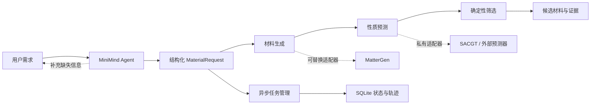

<div align="center">

# 🧲 MagNova

### 基于 MiniMind 的可信磁性材料逆向设计 Agent

**自然语言需求 → 生成 → 预测 → 筛选 → 可追溯候选材料**

[English](README.md) · [系统架构](docs/system-architecture.md) · [公开边界](docs/public-release-scope.md)

</div>

## 项目简介

MagNova 是一个面向磁性材料逆向设计的 AI for Science 研究平台。系统希望把科研人员的自然语言需求转换为可校验、可执行、可追踪的材料发现工作流，并依次完成结构生成、性质预测、确定性筛选与候选排序。

本仓库公开的是 **Agent 与工程编排层**：MiniMind 负责理解需求和多轮澄清；Pydantic Schema、确定性程序和科学模型分别负责输入校验、工具执行、数值判断和候选筛选。

> [!IMPORTANT]
> 当前是研究预览版。内置后端产生的是用于验证工程链路的模拟候选，不代表 DFT 或实验确认的材料发现。

## 系统流程



LLM 不直接充当科学裁判。它把语言转换为结构化需求并解释任务状态；材料生成、性质预测和数值筛选仍由专门模型和确定性代码执行。

## 公开内容

- MiniMind/OpenAI 兼容需求解释器与规则 Baseline；
- 严格的 Pydantic 请求、任务、事件和候选 Schema；
- 缺失信息澄清、多轮槽位合并与会话隔离；
- submit/poll 异步协议、指数退避、重试、超时和失败处理；
- SQLite 任务持久化、增量迁移与工作流轨迹；
- 可替换的生成器、预测器、筛选器接口和端到端 Mock 后端；
- Streamlit 非阻塞演示界面；
- MiniMind SFT、评测、Tokenizer/Embedding 检查与导出工具；
- MatterGen → MatterSim 生成和稳定性筛选实验；
- 自动测试、黄金样例和脱敏后的聚合评测结果。

不公开模型权重、完整训练/测试数据、SACGT 源码与算法细节、内部实验数据、服务凭据、运行日志及大体积结构文件。详见[公开边界](docs/public-release-scope.md)。

## 快速开始

默认配置可以仅使用规则解析器与 Mock 科学工作流在本机运行：

```bash
git clone git@github.com:BaikelWang/MagNova.git
cd MagNova

python -m venv .venv
source .venv/bin/activate  # Windows: .venv\Scripts\activate
python -m pip install -e ".[dev,ui]"

pytest
magnova-agent "生成带隙大于 1.2 eV 的材料"
streamlit run scripts/agent/web_app.py
```

未启动 MiniMind 推理服务时，请在页面中选择“规则 Baseline”。

### 接入 MiniMind

模型权重不随本仓库发布。单独启动 OpenAI 兼容的 MiniMind 推理服务后设置：

```bash
export MINIMIND_API_URL=http://127.0.0.1:8504/v1/chat/completions
streamlit run scripts/agent/web_app.py
```

[`training/minimind`](training/minimind) 保留了从基础权重准备、SFT、评测分析到 Hugging Face 格式导出的学习型工程脚本。

### 接入真实 MagNova 后端

```bash
export MAGNOVA_BASE_URL=http://127.0.0.1:9000
export MAGNOVA_API_KEY=your-token
```

Agent 使用异步任务契约：

```text
POST /v1/tasks           → task_id + queued
GET  /v1/tasks/{task_id} → queued | running | succeeded | failed
```

所有外部响应必须先通过 Pydantic 校验，才能进入 Agent 状态机。

## 当前进展

- [x] 自然语言材料需求结构化
- [x] 多轮澄清与安全回退
- [x] 异步任务协议、持久化和工作流轨迹
- [x] 生成—预测—筛选可替换接口
- [x] MiniMind SFT 与评测工具链
- [x] MatterGen + MatterSim 小规模筛选实验
- [ ] 真实 MagNova 服务接入
- [ ] 校准不确定性与 OOD 门控
- [ ] Pareto 排序与多样性筛选
- [ ] DFT 验证和证据档案
- [ ] 高成本科研动作的人类确认机制

## 科学边界

- Mock 候选始终明确标记为模拟结果；
- 生成结构不等于稳定、磁性、可合成或具有新颖性；
- 代理模型筛选不能替代 DFT 和实验；
- LLM 可以解释结果，但数值约束必须由确定性程序执行；
- 私有科学模型应通过适配器提供来源、不确定性和适用域信息。

## 致谢与许可

项目参考并使用 [MiniMind](https://github.com/jingyaogong/minimind)、[MatterGen](https://github.com/microsoft/mattergen)、[MatterSim](https://github.com/microsoft/mattersim)、Pydantic 与 Streamlit。上游软件和资产遵循各自许可证，本仓库不重新分发其模型权重。

本仓库的 MagNova 原创代码暂未授予开源许可证，仅用于项目展示与学习交流。