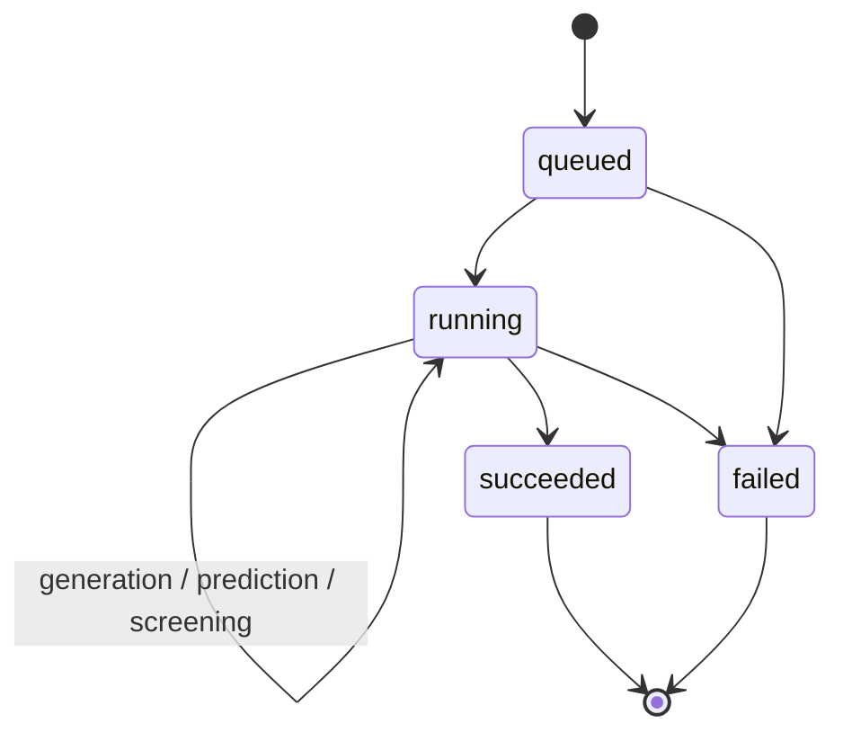

# MagNova system architecture

## Competition system and public baseline

The competition system connects evidence retrieval, MiniMind requirement understanding, deterministic validation and clarification, explicit user confirmation, durable task orchestration, and scientific tools. MatterGen proposes structures, MatterSim participates in relaxation, and the private SACGT service supplies proxy predictions and risk signals. Candidate structure, property fields, CIF and explanation share a task-level provenance boundary. DFT and experimental validation remain separate scientific steps.

The diagram describes the completed competition system, **not a promise that cloning this repository reproduces every service shown**. The original public code baseline is retained. Its contracts and extension points are documented below; production-specific authentication, confirmation, model assets, retrieval corpus and the latest deployment Harness are not newly published by this showcase update.

See [the historical case](showcase-case.md) and [public release scope](public-release-scope.md).

## Responsibility boundary

MagNova separates language reasoning from scientific computation:

1. **MiniMind Agent** interprets the user's intent, fills a typed request, asks focused clarification questions, and explains state.
2. **Orchestrator** validates inputs, submits exactly one task, persists state, retries transient failures, and enforces deadlines.
3. **Generator** proposes crystal structures through a replaceable adapter such as MatterGen.
4. **Predictor** evaluates requested properties through one or more private or external services.
5. **Screener** applies deterministic constraints, ranking, and future uncertainty/OOD policies.
6. **Evidence layer** records provenance, intermediate artifacts, warnings, and final candidate rationale.

The public repository implements the first two responsibilities, stable interfaces for the remaining stages, and an end-to-end mock backend.

## Core contracts

`MaterialRequest` is the boundary between the LLM and the workflow. It captures task type, material family, typed property constraints, required/excluded elements, unresolved free-text constraints, readiness status, and parser warnings.

External tools never receive raw LLM text. Responses are validated as typed job snapshots and candidate objects before they are persisted or displayed.

## Long-running task model

The submit operation is separated from polling. A stable task ID and session ID allow the UI to refresh without duplicating work. SQLite uses WAL mode and additive schema migrations for the single-node MVP.

## Replaceable tool boundary

The public `MagNovaToolAdapter` supports an in-memory backend and an HTTP backend. A production service should add authenticated per-user access, durable queues, idempotency, cancellation, artifact storage, model provenance, calibrated uncertainty, applicability-domain metadata, and approval gates for expensive scientific actions.

## Scientific safety

LLM output, stored records, and remote service responses are all treated as untrusted boundary inputs. Numerical comparisons are deterministic. The public mock backend is intentionally incapable of making scientific claims.
